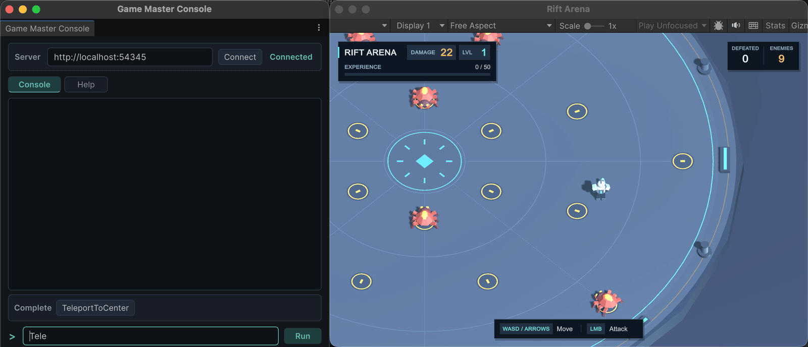

# GameMaster Console

Register debug commands in Unity and run them from the Unity Editor or a terminal while the game is running.

## Install

With Git installed, open **Window → Package Manager** in Unity, click **+**, choose the Git URL option, and enter `https://github.com/kekchpek/GameMasterConsole.git`. If your scripts use an assembly definition, reference `GameMasterConsole`.

## Register a command

Save this as `PlayerDebugCommands.cs` and attach it to the player in a development scene.

```csharp
using GMConsole;
using UnityEngine;

public sealed class PlayerDebugCommands : MonoBehaviour
{
    private void Awake()
    {
        GameMaster.RegisterCommand("TeleportToCenter", "Move the player to the origin.", TeleportToCenter);
        GameMaster.StartServer();
    }

    private void OnDestroy()
    {
        GameMaster.UnregisterCommand("TeleportToCenter");
        GameMaster.StopServer();
    }

    private void TeleportToCenter(GMArgs args)
    {
        transform.position = Vector3.zero;
        args.SetResult("Player moved to the origin.");
    }
}
```

`RegisterCommand` takes a name, a description shown by `help`, and a handler. In handlers with arguments, use `GMArgs.TryGetFloat` and `GMArgs.TryGetString` to read values and `SetResult` to return a message. Start and stop the shared server from one component. Other components can register their commands and unregister them when destroyed.

## Run commands

Enter **Play Mode** and open **Window → Game Master**. The default server address is `http://localhost:54345`.

- **Launch GUI** opens the console inside Unity. Press **Enter** or click **Run** to execute the input. Use **Help** for the server's command descriptions, **Tab** to complete a command name, and **↑ / ↓** to recall distinct commands. Click a **Recent** button to run a command again. To use a different server, enter its URL and click **Connect**.
- **Launch Terminal** opens the Python client. The launcher sets up the environment if Python 3 is installed. The client tries localhost first, then looks for servers on the local network via SSDP. Enter `help` to list commands and use **↑ / ↓** to recall distinct commands.

Enter `TeleportToCenter` in either client to move the player to the scene origin.



## View Unity logs

Open **Logs** in the GUI to see messages from the connected game. The server keeps the latest 1,000 entries from the time it starts. Search the messages, filter by severity, or select an entry to inspect its stack trace.

## Connect to a build

Register commands and start GameMaster Console from the game's startup code in development or release builds. For a build running on the same computer, connect to `http://localhost:54345`.

To connect to a build running on another computer or an Android or iOS device, start the server with `GameMaster.StartServer(allowNetworkAccess: true)`. Keep the build running on the same local development network and use the device's IP address, for example `http://192.168.1.42:54345`. On Android, set **Internet Access** to **Require** in Player Settings to include the network permission.

Enter the address under **Server** in the GUI and click **Connect**. To use the terminal client, pass the address with `--server` to the [terminal launcher](Tools~/Client/README.md).
