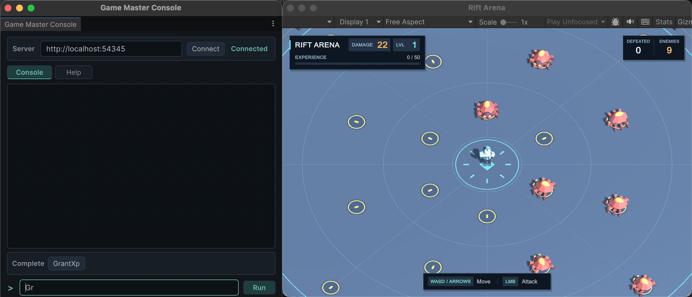

# GameMaster Console

Register debug commands in Unity and run them from the Unity Editor or a terminal while the game is running.

## Install

With Git installed, open **Window → Package Manager → + → Install package from git URL** in Unity 6.2 or newer and enter `https://github.com/kekchpek/GameMasterConsole.git`. If your scripts use an assembly definition, reference `GameMasterConsole`.

## Register a command

Save this as `PlayerDebugCommands.cs` and attach it to the player in a development scene. It implements a simple version of Rift Arena's `TeleportToCenter` command.

```csharp
using GMConsole;
using UnityEngine;

public sealed class PlayerDebugCommands : MonoBehaviour
{
    private void Awake()
    {
        GameMaster.RegisterCommand("TeleportToCenter", "Move the player to the origin.", TeleportToCenter);
        GameMaster.StartServer();
    }

    private void OnDestroy()
    {
        GameMaster.UnregisterCommand("TeleportToCenter");
        GameMaster.StopServer();
    }

    private void TeleportToCenter(GMArgs args)
    {
        transform.position = Vector3.zero;
        args.SetResult("Player moved to the origin.");
    }
}
```

`RegisterCommand` takes a name, a description shown by `help`, and a handler. In handlers with arguments, use `GMArgs.TryGetFloat` and `GMArgs.TryGetString` to read values and `SetResult` to return a message. Start and stop the shared server from one component. Other components can register their commands and unregister them when destroyed.

## Run commands

Enter **Play Mode** and open **Window → Game Master**. The default server address is `http://localhost:54345`.

- **Launch GUI** opens the console inside Unity. Press **Enter** or click **Run** to execute the input. Use **Help** for the server's command descriptions, **Tab** to complete a command name, and **↑ / ↓** to recall distinct commands. Click a **Recent** button to run a command again. To use a different server, enter its URL and click **Connect**.
- **Launch Terminal** opens the Python client. The launcher sets up the environment if Python 3 is installed. The client tries localhost first, then looks for servers on the local network via SSDP. Enter `help` to list commands and use **↑ / ↓** to recall distinct commands.

## Try Rift Arena

Clone the [GameMasterConsoleEnv demo](https://github.com/kekchpek/GameMasterConsoleEnv) with its submodule.

```sh
git clone --recurse-submodules https://github.com/kekchpek/GameMasterConsoleEnv.git
```

Open `Assets/ArenaDemo/RiftArena.unity` and press **Play**. The demo registers its commands in [ArenaDemo.cs](https://github.com/kekchpek/GameMasterConsoleEnv/blob/main/Assets/ArenaDemo/ArenaDemo.cs).

| Command | Effect in Rift Arena |
| --- | --- |
| `GrantXp 150` | Adds 150 XP and takes a new player from level 1 to level 3. |
| `SetLevel 5` | Sets the player's level to 5 and resets XP progress within that level. |
| `SpawnEnemy 3` | Spawns three enemies on the arena floor. |
| `SpawnCenterEnemies` | Spawns ten enemies near the center if there is room. |
| `TeleportToCenter` | Returns the player and camera to the center. |


