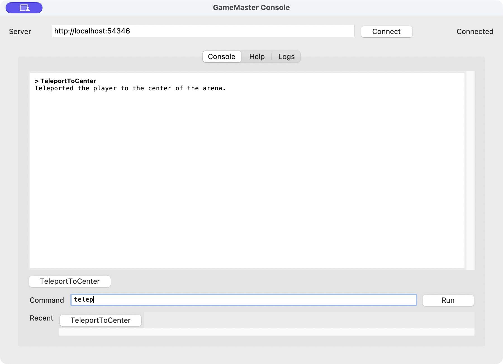
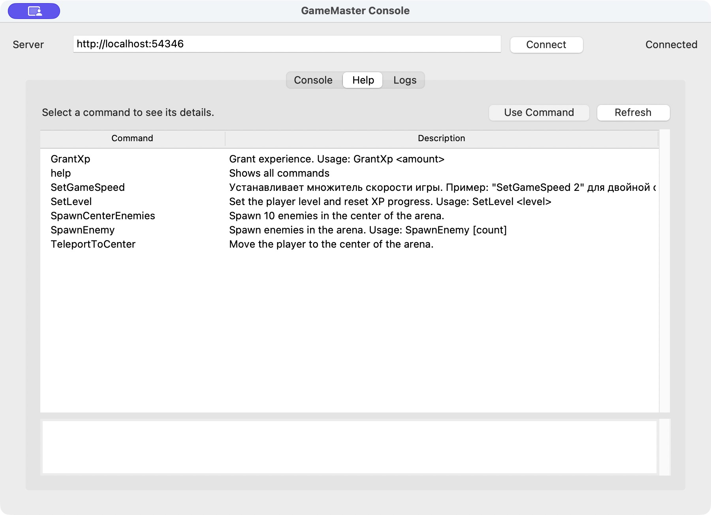
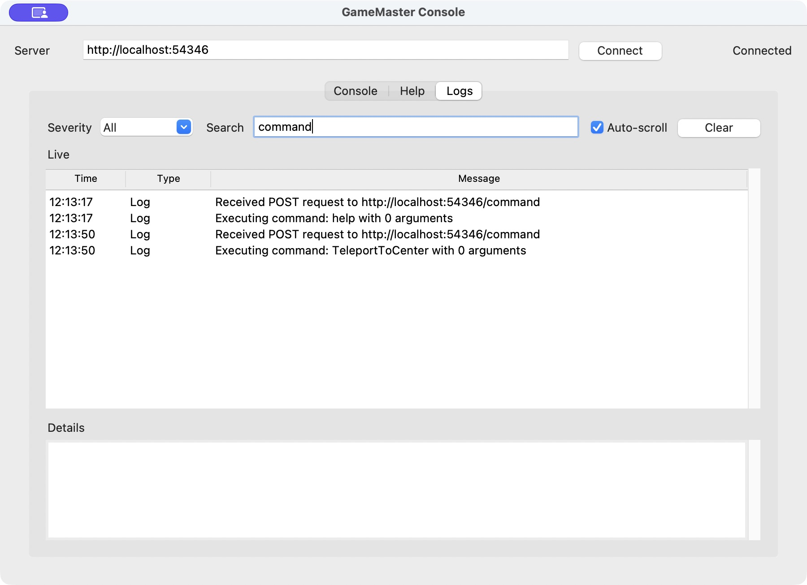

# GameMaster Console

Register debug commands in Unity and run them from a standalone Python desktop app or a terminal while the game is running.

## Install

With Git installed, open **Window → Package Manager** in Unity, click **+**, choose the Git URL option, and enter `https://github.com/kekchpek/GameMasterConsole.git`. If your scripts use an assembly definition, reference `GameMasterConsole`.

## Register a command

Save this as `PlayerDebugCommands.cs` and attach it to the player in a development scene.

```csharp
using GMConsole;
using UnityEngine;

public sealed class PlayerDebugCommands : MonoBehaviour
{
    private void Awake()
    {
        GameMaster.RegisterCommand("TeleportToCenter", "Move the player to the origin.", TeleportToCenter);
        GameMaster.StartServer();
    }

    private void OnDestroy()
    {
        GameMaster.UnregisterCommand("TeleportToCenter");
        GameMaster.StopServer();
    }

    private void TeleportToCenter(GMArgs args)
    {
        transform.position = Vector3.zero;
        args.SetResult("Player moved to the origin.");
    }
}
```

`RegisterCommand` takes a name, a description shown by `help`, and a handler. In handlers with arguments, use `GMArgs.TryGetFloat` and `GMArgs.TryGetString` to read values and `SetResult` to return a message. Start and stop the shared server from one component. Other components can register their commands and unregister them when destroyed.

## Run commands

Enter **Play Mode** or start a development build that runs the GameMaster server.

### Desktop app

GameMaster Console runs in a separate Python desktop window and connects to Unity over HTTP. It requires Python 3 with Tkinter and Tk 8.6 or later. The app uses Python's standard library and can launch offline.

Open **Window → Game Master → Launch GUI** in Unity, or run `./run_gui.sh` on macOS or Linux or `run_gui.bat` on Windows from `Tools~/Client` in a checkout of this repository. See the [Python client setup](Tools~/Client/README.md) for platform instructions.

The GUI connects to `http://localhost:54345` by default and retries automatically if the game server is still starting. To switch to a different editor or build, enter its URL under **Server** and click **Connect**. The screenshots below show a connection to the Rift Arena demo.

#### Console

Type a command and press **Enter** or click **Run** to see the game's response. Press **Tab** to complete a command name and **↑ / ↓** to browse command history. Click a command under **Recent** to run it again. In Rift Arena, `TeleportToCenter` moves the player to the center of the arena.



#### Help

Browse the commands registered by the connected game and their descriptions. Select a row to read the full description. Click **Use Command** to insert its name in the console, where you can add arguments before running it. Click **Refresh** after changing the game's registered commands.



#### Logs

Watch Unity logs as they arrive. The server keeps up to 1,000 entries from the current session. Filter by severity, search messages and stack traces, or select an entry to see both in **Details**. **Auto-scroll** follows the newest entries.



### Terminal

Choose **Window → Game Master → Launch Terminal** in Unity, or run the terminal launcher from `Tools~/Client`. The terminal client tries localhost first, then looks for servers on the local network via SSDP. Enter `help` to list commands and use **↑ / ↓** to recall distinct commands.

In the sample above, enter `TeleportToCenter` to move the player to the scene origin.

## Connect to a build

Register commands and start GameMaster Console from the game's startup code in development or release builds. For a build running on the same computer, connect to `http://localhost:54345`.

To connect to a build running on another computer or an Android or iOS device, start the server with `GameMaster.StartServer(allowNetworkAccess: true)`. Keep the build running on the same local development network and use the device's IP address, for example `http://192.168.1.42:54345`. On Android, set **Internet Access** to **Require** in Player Settings to include the network permission.

Enter the address under **Server** in the desktop app and click **Connect**. Both [Python client launchers](Tools~/Client/README.md) also accept `--server`.
